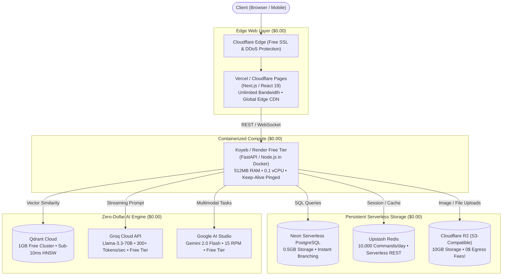

<div align="center">

  <h1>⚡ Zero-Bill Cloud Stack</h1>

  <p><strong>A battle-tested architectural guide and curated matrix of verified $0.00 cloud infrastructure, serverless databases, free GPU clusters, and high-speed AI APIs — with zero credit card traps.</strong></p>

  <p>
    
    
    
    
  </p>

  <p>
    <a href="#-the-000-production-reference-architecture"></a>
    <a href="#-the-free-tier-infrastructure-matrix"></a>
    <a href="#-deep-dive-by-layer"></a>
    <a href="#-the-anti-sleep--keep-alive-protocol"></a>
    
  </p>

  <sub>Star ⭐ this repository to bookmark this $0.00 cloud architecture for your personal projects, hackathons, and production deployments!</sub>

</div>

---

## 📑 Table of Contents

- [💡 Why Zero-Bill Cloud Stack?](#-why-zero-bill-cloud-stack)
- [🏗️ The $0.00 Production Reference Architecture](#️-the-000-production-reference-architecture)
- [📊 The Free-Tier Infrastructure Matrix (Quick Specs)](#-the-free-tier-infrastructure-matrix-quick-specs)
- [🔍 Deep Dive by Infrastructure Layer](#-deep-dive-by-infrastructure-layer)
  - [1. Frontend & Edge Hosting (Static, SSR & CDN)](#1-frontend--edge-hosting-static-ssr--cdn)
  - [2. Backend Compute & Docker Container Runners](#2-backend-compute--docker-container-runners)
  - [3. Managed Relational & Key-Value Databases](#3-managed-relational--key-value-databases)
  - [4. Managed Vector Databases for AI & RAG](#4-managed-vector-databases-for-ai--rag)
  - [5. Free GPU Labs & High-Speed LLM Inference APIs](#5-free-gpu-labs--high-speed-llm-inference-apis)
  - [6. Object Storage with Zero Egress Fees](#6-object-storage-with-zero-egress-fees)
  - [7. Student Developer Grants & Cloud Credits ($10,000+ Value)](#7-student-developer-grants--cloud-credits-10000-value)
- [🛡️ The Anti-Sleep & Keep-Alive Protocol (Ethical Production Hack)](#️-the-anti-sleep--keep-alive-protocol-ethical-production-hack)
- [⭐ Explore My Other Repositories](#-explore-my-other-repositories)
- [🤝 Contributing](#-contributing)
- [📜 License](#-license)

---

## 💡 Why Zero-Bill Cloud Stack?

Building full-stack AI applications, microservices, and databases should not cost \$50/month in idle cloud bills. 

Major cloud providers (AWS, GCP, Azure) are infamous for predatory billing traps: **unmonitored egress bandwidth fees, forgotten NAT gateways (\$32/mo), and idle database instances**. Most students and indie developers abandon their projects out of fear of unexpected charges.

However, modern serverless providers offer generous, production-ready free tiers that can be assembled into a **$0.00/month high-availability architecture capable of handling thousands of real users**.

This repository documents the exact specs, hardware limitations, cold-start workarounds, and blueprints required to build and deploy modern apps for **\$0.00 forever**.

---

## 🏗️ The $0.00 Production Reference Architecture

The diagram below illustrates how to connect 100% free-tier services into a cohesive, highly responsive, production-ready full-stack AI application:



---

## 📊 The Free-Tier Infrastructure Matrix (Quick Specs)

| Service | Category | Free Tier Specs | Credit Card? | Cold Start / Sleeping? |
| :--- | :--- | :--- | :---: | :---: |
| **Cloudflare Pages** | Frontend / Static | Unlimited bandwidth, global CDN, custom domains | ❌ **No** | None (Instant Edge) |
| **Vercel** | Frontend / SSR | 100GB bandwidth, serverless edge functions | ❌ **No** | None ($<50\text{ms}$ cold start) |
| **Koyeb** | Backend Container | 512MB RAM, 0.1 vCPU, 2GB SSD, global edge | ❌ **No** | None (Stays awake) |
| **Render** | Backend Container | 512MB RAM, 0.1 CPU, 750 free instance hours | ❌ **No** | Yes (Sleeps after 15m idle) |
| **Neon** | PostgreSQL DB | 0.5GB storage, serverless autoscaling, branching | ❌ **No** | Autosuspend (wakes in $\sim 500\text{ms}$) |
| **Supabase** | PostgreSQL + Auth | 500MB database, 50,000 MAU auth, 1GB storage | ❌ **No** | Pauses after 7 days inactivity |
| **Upstash** | Redis Cache | 10,000 commands/day, 256MB memory, REST API | ❌ **No** | None (True Serverless) |
| **MongoDB Atlas** | Document DB | 512MB shared cluster (M0), replica set | ❌ **No** | None (Always active) |
| **Qdrant Cloud** | Vector DB | 1GB free cluster (approx. $1\text{M}$ vectors) | ❌ **No** | None (Always active) |
| **Cloudflare R2** | Object Storage | 10GB storage, 1M write/mo, 10M read/mo | ❌ **No** | None (Zero Egress Fees) |
| **Groq Cloud** | AI Inference | Llama-3.3-70B, Whisper, 30 req/min, 500 t/s | ❌ **No** | None (Ultra-fast TPU/LPU) |
| **Google AI Studio** | Multimodal AI | Gemini 2.0 Flash, 15 RPM, 1500 req/day | ❌ **No** | None (Google Cloud Scale) |

---

## 🔍 Deep Dive by Infrastructure Layer

---

### 1. Frontend & Edge Hosting (Static, SSR & CDN)

#### [Cloudflare Pages](https://pages.cloudflare.com/)
* **Free Specs:** Unlimited bandwidth, unlimited requests, 500 builds/month, free automatic SSL, unlimited custom domains.
* **Why it's elite:** Unlike Vercel, Cloudflare Pages **does not impose arbitrary bandwidth caps**. It runs on Cloudflare's 300+ city edge network.
* **Limitations:** Dynamic Node.js server-side rendering requires Cloudflare Workers syntax (V8 isolate runtime, not full Node.js).

#### [Vercel](https://vercel.com/)
* **Free Specs:** 100GB bandwidth/month, 100 edge function executions/day, zero-config Next.js deployment.
* **Why it's elite:** Best-in-class developer experience for Next.js, React, and SvelteKit. Automatic preview deployments on pull requests.
* **Limitations:** Commercial use policies strictly enforced on the hobby tier; 10-second timeout on serverless functions.

---

### 2. Backend Compute & Docker Container Runners

#### [Koyeb](https://www.koyeb.com/)
* **Free Specs:** 1 free `nano` microVM instance (512MB RAM, 0.1 vCPU, 2GB NVMe disk), 55 free monthly hours per day pool.
* **Why it's elite:** **It does not sleep on idle**. Unlike Render, Koyeb instances remain continuously awake on their free tier, eliminating embarrassing 50-second cold starts when demoing apps to recruiters.
* **Deployment:** Deploy directly from a GitHub repository or pre-built Docker container image from Docker Hub / GitHub Container Registry.

#### [Render](https://render.com/)
* **Free Specs:** 512MB RAM, 0.1 vCPU, 750 free instance hours per month.
* **The Gotcha:** Spins down after **15 minutes of inactivity**. The first incoming request takes $45\text{--}60\text{ seconds}$ to wake up the container.
* **The Workaround:** Use an external health-check ping (see the [Anti-Sleep Protocol](#️-the-anti-sleep--keep-alive-protocol-ethical-production-hack) below).

---

### 3. Managed Relational & Key-Value Databases

#### [Neon Serverless PostgreSQL](https://neon.tech/)
* **Free Specs:** 0.5GB storage, 1 project, 10 branches, 100 compute hours/month.
* **Why it's elite:** 
  1. **Instant Database Branching:** Create instant, isolated copies of your production schema and data in $<1\text{ second}$ to test database migrations.
  2. **Connection Pooling:** Built-in PgBouncer connection pooling via port `6543`, supporting up to 10,000 concurrent serverless connections.
* **Gotcha:** Compute suspends after 5 minutes of inactivity; auto-resumes on next SQL query within $\sim 500\text{ms}$.

#### [Upstash (Serverless Redis)](https://upstash.com/)
* **Free Specs:** 10,000 commands per day, 256MB memory cap, TLS encryption.
* **Why it's elite:** True serverless Redis accessible via **HTTP REST API** as well as standard TCP sockets. You can query Redis directly from serverless edge functions without connection-pool exhaustion.
* **Best use case:** Rate-limiting API endpoints, caching LLM responses, and storing active user session tokens.

---

### 4. Managed Vector Databases for AI & RAG

#### [Qdrant Cloud](https://cloud.qdrant.io/)
* **Free Specs:** 1 free perpetual cluster, 1GB RAM, 0.5 vCPU, 4GB disk storage.
* **Capacity:** Comfortably stores up to **$1{,}000{,}000$ dense embedding vectors** ($1536$-dim with scalar quantization).
* **Why it's elite:** Written in Rust; delivers sub-$10\text{ms}$ HNSW vector search. Includes rich payload filtering (filter vectors by user ID, date, or tags during retrieval).
* **Credit Card:** 100% free forever without entering credit card details.

---

### 5. Free GPU Labs & High-Speed LLM Inference APIs

#### [Groq Cloud](https://console.groq.com/)
* **Free Specs:** Free API access to `llama-3.3-70b-versatile`, `mixtral-8x7b-32768`, and `whisper-large-v3`.
* **Throughput:** $300\text{--}500\text{ tokens/second}$ powered by custom LPU (Language Processing Unit) hardware.
* **Rate Limits:** 30 requests/minute, 14,400 requests/day on the free tier.
* **Best use case:** Fast RAG synthesis, intent routing, and real-time streaming conversational agents.

#### [Google AI Studio (Gemini APIs)](https://aistudio.google.com/)
* **Free Specs:** Free developer access to `gemini-2.0-flash` and `gemini-1.5-pro`.
* **Rate Limits:** 15 Requests Per Minute (RPM), 1,500 Requests Per Day (RPD), 1 Million tokens/minute.
* **Best use case:** Multimodal reasoning (parsing PDFs, images, YouTube video transcripts, audio files) with a massive 1M token context window.

#### [Kaggle Notebooks](https://www.kaggle.com/)
* **Free Specs:** **30 hours per week** of free hardware acceleration.
* **Hardware Options:** Dual NVIDIA Tesla T4 GPUs ($2\times 16\text{GB}$ VRAM) or single NVIDIA P100 ($16\text{GB}$ VRAM).
* **Best use case:** Fine-tuning embedding models, testing PyTorch pipelines, and running batch inference scripts.

---

### 6. Object Storage with Zero Egress Fees

#### [Cloudflare R2](https://www.cloudflare.com/developer-platform/r2/)
* **Free Specs:** 10GB storage per month, 1,000,000 Class A operations (writes), 10,000,000 Class B operations (reads).
* **The Killer Advantage:** **ZERO Bandwidth Egress Fees**. AWS S3 charges $\$0.09\text{ per GB}$ whenever a user downloads an image from your bucket. Cloudflare R2 charges **$0.00** egress forever.
* **API Compatibility:** 100% compatible with the standard AWS S3 SDK (`boto3` in Python, `@aws-sdk/client-s3` in Node.js).

---

### 7. Student Developer Grants & Cloud Credits ($10,000+ Value)

If you have an active `.edu` or college student email ID, you can unlock over **\$10,000** in verified commercial developer credits:

| Program | Free Perks Included | Verification Method |
| :--- | :--- | :--- |
| **[GitHub Student Developer Pack](https://education.github.com/pack)** | • \$200 DigitalOcean credits<br>• Free 1-year domain name on Namecheap<br>• Free JetBrains All-Products IDE pack<br>• Free Termius SSH client<br>• GitHub Copilot Pro free access | College Email / Student ID card |
| **[AWS Educate](https://aws.amazon.com/education/awseducate/)** | • \$100 cloud credits directly in AWS console<br>• No credit card required<br>• Hands-on sandbox labs | Student Email |
| **[Google Cloud for Students](https://cloud.google.com/edu/students)** | • \$300 credits for Google Cloud compute & Vertex AI<br>• Access to Google Cloud Skills Boost labs | College Affiliation |
| **[Notion for Education](https://www.notion.so/product/notion-for-education)** | • Free Notion Plus Plan with unlimited file uploads | Student Email |

---

## 🛡️ The Anti-Sleep & Keep-Alive Protocol (Ethical Production Hack)

Free container hosts like **Render** shut down instances after 15 minutes of inactivity to save compute. When a recruiter or interviewer clicks your portfolio demo link, they stare at a blank screen for 60 seconds while the container boots.

### The Solution: Free Keep-Alive Health Probe

Create a lightweight, harmless `/health` endpoint in your FastAPI or Express app, then configure a free external pinger to hit it every **14 minutes**.

#### Step 1: Add a lightweight Healthcheck Endpoint
```python
# main.py (FastAPI)
from fastapi import FastAPI, Response, status

app = FastAPI()

@app.get("/health", status_code=status.HTTP_200_OK)
async def health_check():
    """Ultra-fast 2ms healthcheck returning empty 204 response."""
    return Response(status_code=status.HTTP_204_NO_CONTENT)
```

#### Step 2: Set up an Automated 14-Minute Ping
Choose either of these **100% free** methods:

* **Option A: [Cron-job.org](https://cron-job.org/) (Recommended)**
  1. Create a free account (no credit card).
  2. Create a new cron job pointing to: `https://your-api.onrender.com/health`.
  3. Set execution schedule to: **Every 14 minutes**.
* **Option B: GitHub Actions Scheduled Cron**
  Create `.github/workflows/keep_alive.yml` in your repository:
  ```yaml
  name: Keep-Alive Ping
  on:
    schedule:
      - cron: '*/14 * * * *'
  jobs:
    ping:
      runs-on: ubuntu-latest
      steps:
        - name: Curl Endpoint
          run: curl -s https://your-api.onrender.com/health || true
  ```

---

## ⭐ Explore My Other Repositories

| Repository | Description | Domain |
| :--- | :--- | :--- |
| 🧠 [**LLM-System-Patterns**](https://github.com/Gana-Y/LLM-System-Patterns) | Production design patterns, latency budgets, failure modes, and architectural trade-offs for real-world LLMs & AI agents. | `AI System Design` |
| 🚀 [**Florix_AI**](https://github.com/Gana-Y/Florix_AI) | Production-grade multimodal AI study platform with in-database RAG, adaptive spaced repetition, and interactive viva defenses. | `Full-Stack RAG / AI` |
| ⚡ [**vesper-engine**](https://github.com/Gana-Y/vesper-engine) | Hardened, high-performance sandboxed code execution engine & online judge arbiter enforcing Linux cgroups and microsecond telemetry. | `Systems / Linux / Python` |
| 📈 [**OrderCore**](https://github.com/Gana-Y/OrderCore) | High-throughput Limit Order Book & matching engine in Python (FastAPI/WebSockets) achieving 136k orders/sec with $4.3\mu\text{s}$ latency. | `Low-Latency Systems / FinTech` |
| 🎓 [**Free-Courses**](https://github.com/Gana-Y/Free-Courses) | Curated catalog of verified 100% free technical courses & certifications from NVIDIA, Anthropic, AWS, Google, Harvard, and MIT. | `Developer Education` |
| 📚 [**AI-ML-Notes**](https://github.com/Gana-Y/AI-ML-Notes) | Comprehensive study notes, summaries, and mathematical breakdowns across AI, ML, Deep Learning, and LLMs. | `Study Notes / AI & ML` |

---

## 🤝 Contributing

Contributions, new zero-dollar services, and verified free-tier limits are welcome!

1. Fork this repository (`git checkout -b feature/add-new-free-tier`).
2. Add the service with exact RAM/storage specifications and verify that **no credit card is required**.
3. Commit with a semantic message (`git commit -m "feat: add [Service Name] free tier specs"`).
4. Open a Pull Request.

---

## 🌟 Show Your Support — Star This Repo!

If this matrix and architecture guide saved you from unexpected cloud bills or helped you deploy a project for $0.00:

* ⭐ **Give this repository a star** — it directly supports free, barrier-free developer tools and helps fellow builders find it!
* 🍴 **Fork it** — use it as your personal launchpad for hackathons and production deployments.
* 📢 **Share it** — spread the word to student groups, indie hackers, or on LinkedIn & X (Twitter)!

---

## 👨‍💻 Maintainer

Maintained with ❤️ by **[Ganesh Yandigeri](https://github.com/Gana-Y)**

- 🌐 **Portfolio:** [ganesh-portfolio-silk-five.vercel.app](https://ganesh-portfolio-silk-five.vercel.app)
- 💼 **LinkedIn:** [linkedin.com/in/ganesh-yandigeri](https://linkedin.com/in/ganesh-yandigeri)
- 🐙 **GitHub:** [@Gana-Y](https://github.com/Gana-Y)

---

## 📜 License

Distributed under the [MIT License](LICENSE). Build fearlessly without cloud bills!
